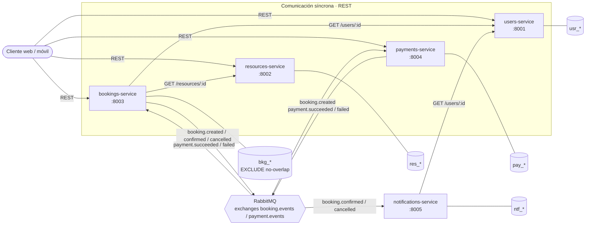
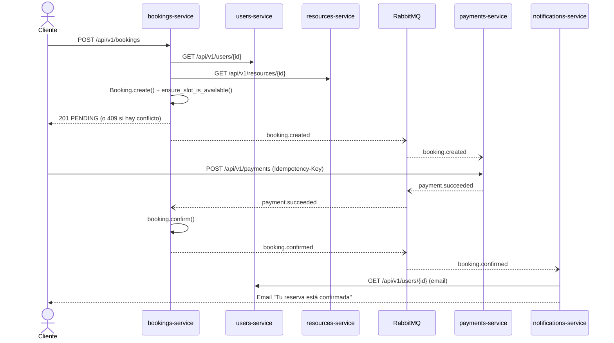

# Plataforma de reservas de salas y recursos

Sistema para reservar salas, equipos y puestos de trabajo, diseñado para **evolucionar**:
empieza con lo mínimo (usuarios y reservas) pero sus límites ya contemplan pagos,
notificaciones, seguridad y procesamiento asíncrono.

> Ejercicio práctico de *Arquitectura de software: diseñar para evolucionar*.
> La regla clave del dominio es **evitar conflictos de disponibilidad**: un recurso no
> puede tener dos reservas activas que se solapen en el tiempo.

## Tres decisiones clave

| Decisión | Elección | Por qué (justificada por el dominio) | Costo que aceptamos |
|---|---|---|---|
| Arquitectura del sistema | **Microservicios** + eventos | Usuarios, catálogo, reservas, pagos y notificaciones cambian a ritmos distintos y tienen dueños de datos distintos. Pagos y notificaciones deben poder fallar sin tumbar las reservas. | Latencia de red, observabilidad distribuida, consistencia eventual. [ADR 0001](docs/adr/0001-microservicios.md) |
| Arquitectura interna | **Clean Architecture** en cada servicio | La regla anti-conflictos debe vivir en el dominio, probarse sin base de datos y sobrevivir a cambios de framework. | Más archivos y mapeos entre entidad y modelo ORM. [ADR 0002](docs/adr/0002-clean-architecture.md) |
| Estilo de API | **REST (FastAPI)** + **RabbitMQ** | REST para consultas y comandos que necesitan respuesta inmediata; eventos para lo que puede ocurrir después (notificar, confirmar tras pago). | Acoplamiento temporal en las llamadas REST; entrega "al menos una vez" en eventos. [ADR 0003](docs/adr/0003-rest-y-eventos.md) |

## Diagrama de arquitectura del sistema



Cada servicio es dueño exclusivo de sus tablas. Nadie lee la base de otro servicio ni
importa sus modelos ORM: se integran solo por los [contratos REST](docs/contracts/rest.md)
y los [contratos de eventos](docs/contracts/events.md).

## Responsabilidades y límites de los servicios

| Servicio | Responsabilidad única de negocio | Datos que posee | Expone | Consume | Estado |
|---|---|---|---|---|---|
| **users-service** | Identidad y perfiles | `usr_users` | REST `/api/v1/users` | — | ✅ Funcional |
| **resources-service** | Definición de recursos, características y horarios de disponibilidad | `res_resources`, `res_availability_windows` | REST `/api/v1/resources` | — | 🧱 Estructurado |
| **bookings-service** | Reglas de reserva, **detección de conflictos** y estados | `bkg_bookings` | REST `/api/v1/bookings`, eventos `booking.*` | REST users/resources, evento `payment.*` | ✅ Funcional |
| **payments-service** | Pagos simulados e integridad de transacciones | `pay_payments` | REST `/api/v1/payments`, eventos `payment.*` | evento `booking.created` | 🧱 Estructurado |
| **notifications-service** | Notificaciones tras confirmaciones y cambios | `ntf_notifications` | — | eventos `booking.confirmed`, `booking.cancelled`; REST users | 🧱 Estructurado |

Límites que se cuidan a propósito:

- **Disponibilidad ≠ ocupación.** resources-service define *cuándo se puede reservar* un
  recurso (horario operativo); bookings-service sabe *qué está ocupado*. Así ningún servicio
  necesita la tabla del otro.
- **Copia de datos, no modelos compartidos.** Al crear una reserva, bookings guarda una copia
  del precio (`total_amount`). Si el recurso cambia de tarifa mañana, la reserva no cambia.
- **Identificadores, no llaves foráneas entre servicios.** `bkg_bookings.user_id` y
  `resource_id` son UUID sin FK a otras bases.
- **No hay un servicio por tabla.** Los horarios de disponibilidad viven dentro de
  resources-service, no en un "availability-service".

## La regla clave: evitar conflictos de disponibilidad

Dos reservas del mismo recurso chocan si ambas están **activas** (`PENDING` o `CONFIRMED`) y sus
horarios se solapan. Los horarios son intervalos semiabiertos `[inicio, fin)`, así que una reserva
de 09:00 a 11:00 y otra de 11:00 a 12:00 **no** chocan.

La regla se aplica en dos niveles:

1. **Dominio** (`booking-service/app/src/domain/services/availability.py`): el caso de uso
   `CreateBooking` busca reservas activas solapadas y la entidad decide si hay conflicto.
   Responde `409 Conflict` con un mensaje claro.
2. **Base de datos** (migración `a1c3e5f7b9d2`): una restricción `EXCLUDE USING gist` de
   PostgreSQL impide físicamente dos filas activas solapadas del mismo recurso. Cubre la carrera
   en la que dos peticiones simultáneas pasan la validación al mismo tiempo; el repositorio
   traduce ese error a la misma excepción de dominio `BookingConflict`.

```text
CONSTRAINT bkg_bookings_no_overlap EXCLUDE USING gist (
    resource_id WITH =,
    tstzrange(start_at, end_at, '[)') WITH &&
) WHERE (status IN ('PENDING', 'CONFIRMED'))
```

Una reserva **cancelada** libera el horario. Una reserva `PENDING` lo bloquea mientras se paga.

## Flujo principal: reservar, pagar y notificar



Mientras llega la sesión de mensajería, `POST /api/v1/bookings/{id}/confirm` hace las veces del
consumidor de `payment.succeeded`, y los eventos se escriben en el log con el mismo formato que
tendrán en RabbitMQ. Cuando se conecte RabbitMQ solo se agrega un adaptador en
`infrastructure/messaging`; dominio y casos de uso no cambian.

## Clean Architecture dentro de cada servicio

```text
<servicio>/
├── app/src/
│   ├── domain/           # Entidades, value objects, invariantes, eventos. Python puro.
│   ├── application/      # Casos de uso, DTOs y puertos (contratos) que Infrastructure implementa.
│   ├── infrastructure/   # SQLModel, repositorios, clientes HTTP, publicadores de eventos.
│   └── presentation/     # Routers FastAPI: adaptan HTTP -> DTO -> caso de uso.
├── alembic/              # Migraciones (solo tablas del servicio, tabla de versiones propia)
├── tests/
├── main.py               # Composición de la app FastAPI
├── pyproject.toml
└── Dockerfile
```

Reglas de dependencias: `Presentation → Application → Domain`. Infrastructure implementa los
puertos definidos en Application. El dominio **no importa** FastAPI, SQLModel ni RabbitMQ (por eso
`user_model.py` pasó de `domain/models` a `infrastructure/persistence/models.py` y el dominio
ahora tiene una entidad `User` en Python puro). Los routers no contienen reglas de negocio.

Recorrido de una solicitud en bookings-service:

```text
POST /api/v1/bookings
  → presentation/api/v1/bookings_router.py      (valida JSON, arma CreateBookingCommand)
  → application/use_cases/create_booking.py     (orquesta: usuario, recurso, conflictos)
  → domain/entities/booking.py + services/      (invariantes y regla anti-conflictos)
  → infrastructure/persistence/...repository.py (SQLModel + Postgres EXCLUDE)
```

## Estructura del repositorio

```text
booking-microservices/
├── README.md                    # Este documento: diseño del sistema
├── docs/
│   ├── adr/                     # Decisiones de arquitectura y sus trade-offs
│   └── contracts/               # Contratos iniciales REST y de eventos
├── user-service/                # ✅ funcional (FastAPI + SQLModel + Alembic)
├── booking-service/             # ✅ funcional (FastAPI + SQLModel + Alembic + tests)
├── resources-service/           # 🧱 estructura Clean + entidad de dominio + puertos
├── payments-service/            # 🧱 estructura Clean + entidad de dominio + puertos
├── notifications-service/       # 🧱 estructura Clean + entidad de dominio + puertos
└── readmemicroservicios.md      # Bitácora de cómo se inicializó el proyecto
```

## Cómo ejecutarlo

Requisitos: Python 3.12 y [uv](https://docs.astral.sh/uv/).

Cada servicio lee `DATABASE_URL` de su propio `.env` (ver `.env.example`). En producción cada
servicio tendría su propia base; en desarrollo pueden compartir la misma base de Neon porque cada
uno usa un prefijo de tablas (`usr_`, `bkg_`, ...), su propia tabla de versiones de Alembic y
filtra en `autogenerate` solo sus tablas. Sin `DATABASE_URL` usan SQLite local.

```bash
# users-service en :8001
cd user-service
cp .env.example .env            # pega tu DATABASE_URL de Neon
uv sync
uv run alembic upgrade head
uv run fastapi dev main.py --port 8001

# bookings-service en :8003 (otra terminal)
cd booking-service
cp .env.example .env            # DATABASE_URL + USERS_SERVICE_URL=http://localhost:8001
uv sync
uv run alembic upgrade head     # crea bkg_bookings y la restricción EXCLUDE (btree_gist)
uv run fastapi dev main.py --port 8003
```

Documentación interactiva en `http://localhost:8001/docs` y `http://localhost:8003/docs`.
Si `RESOURCES_SERVICE_URL` no está definida, bookings-service usa un modo desarrollo que asume
que el recurso existe (con tarifa `DEV_DEFAULT_HOURLY_RATE`) y lo avisa en el log.

Pruebas:

```bash
cd booking-service && uv run pytest     # dominio, casos de uso y API
cd user-service && uv run pytest
# Restricción EXCLUDE contra un Postgres real (base vacía de pruebas):
TEST_POSTGRES_URL=postgresql://... uv run pytest tests/integration
```

## Capacidad de evolución

La arquitectura base no cambia en las siguientes sesiones; cada tema entra por un borde:

| Sesión | Dónde entra |
|---|---|
| 2. Patrones de diseño | Repositorio, adaptador y fábrica ya usados; strategy para políticas de reserva |
| 3. Testing y SonarQube | `tests/` por servicio con fakes de los puertos |
| 4. Ciberseguridad | Middleware JWT en Presentation; `user_id` saldrá del token en vez del cuerpo |
| 5. Idempotencia | `Idempotency-Key` en pagos y `event_id` para deduplicar consumidores |
| 6. Rate limiting y resiliencia | Timeouts ya configurables en los clientes HTTP; reintentos y circuit breaker allí |
| 7. Mensajería y consistencia | `RabbitMQEventPublisher` y consumidores implementando los puertos existentes; expiración de reservas `PENDING` sin pago |
| 8. Observabilidad y Docker | `/health` en cada servicio; Dockerfile por servicio |
| 9–10. CI/CD, GHCR y ECS Fargate | Un pipeline e imagen por servicio, despliegue independiente |
