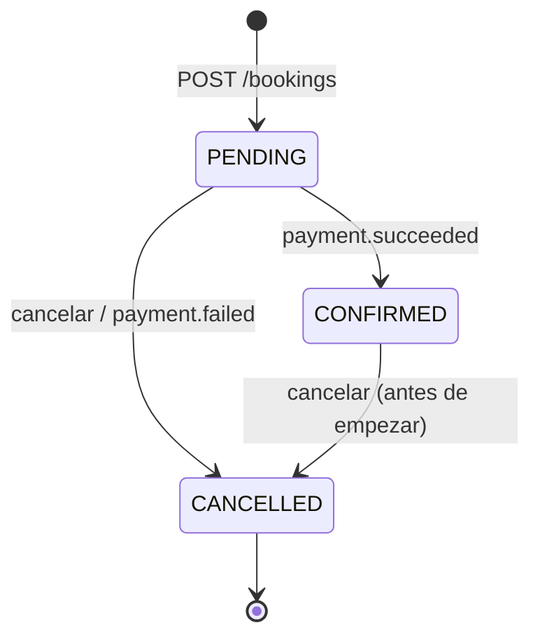

# Contratos REST iniciales

Todas las APIs usan JSON, prefijo `/api/v1`, UUID como identificadores y fechas ISO 8601
**con zona horaria**. Los errores siguen la forma `{"detail": "mensaje"}`.
Un consumidor solo debe depender de los campos que usa (lectura tolerante): agregar campos
nuevos no rompe el contrato; quitarlos o cambiar su significado requiere `/api/v2`.

| Código | Significado |
|---|---|
| `201` | Recurso creado |
| `404` | No existe |
| `409` | Conflicto con el estado actual (horario ocupado, transición inválida, email repetido) |
| `422` | Datos inválidos o regla de negocio violada |
| `503` | Un servicio del que dependemos no respondió |

---

## users-service (`:8001`) ✅ implementado

### `POST /api/v1/users`

```json
{
  "name": "Vane",
  "email": "vane@example.com",
  "identification_type": "CC",
  "identification_number": "1001",
  "birth_date": "1999-05-10"
}
```

`201` → `UserResponse` · `409` email ya registrado · `422` datos inválidos

### `GET /api/v1/users/{user_id}` → `UserResponse` · `404`

```json
{
  "id": "a1a9b994-1e5c-4f9c-b8e4-3af8a8f7d622",
  "name": "Vane",
  "email": "vane@example.com",
  "identification_type": "CC",
  "identification_number": "1001",
  "birth_date": "1999-05-10",
  "is_active": true
}
```

**Consumidores:** bookings-service usa `id` e `is_active`; notifications-service usa `email`.

### `GET /api/v1/users?only_active=true` → `UserResponse[]`
### `POST /api/v1/users/{user_id}/deactivate` → `UserResponse` · `404` · `409` ya inactivo

---

## resources-service (`:8002`) 🧱 contrato definido

### `POST /api/v1/resources`

```json
{
  "name": "Sala Caribe",
  "kind": "ROOM",
  "capacity": 8,
  "hourly_rate": "40000.00",
  "features": ["proyector", "videoconferencia"],
  "availability": [
    {"weekday": 0, "opens_at": "07:00", "closes_at": "19:00"}
  ]
}
```

### `GET /api/v1/resources/{resource_id}` → `ResourceResponse` · `404`

```json
{
  "id": "11111111-1111-1111-1111-111111111111",
  "name": "Sala Caribe",
  "kind": "ROOM",
  "capacity": 8,
  "hourly_rate": "40000.00",
  "features": ["proyector", "videoconferencia"],
  "availability": [{"weekday": 0, "opens_at": "07:00", "closes_at": "19:00"}],
  "is_active": true
}
```

**Consumidor:** bookings-service usa `id`, `is_active` y `hourly_rate`
(ver `booking-service/app/src/infrastructure/clients/http_clients.py`).

### `GET /api/v1/resources?kind=ROOM&min_capacity=4` → `ResourceResponse[]`

---

## bookings-service (`:8003`) ✅ implementado

### `POST /api/v1/bookings`

```json
{
  "user_id": "a1a9b994-1e5c-4f9c-b8e4-3af8a8f7d622",
  "resource_id": "11111111-1111-1111-1111-111111111111",
  "start_at": "2026-11-03T09:00:00-05:00",
  "end_at": "2026-11-03T11:00:00-05:00"
}
```

- `201` → `BookingResponse` con `status: "PENDING"` y el precio congelado.
- `409` → el recurso ya tiene una reserva activa que se solapa:
  `{"detail": "El recurso 1111... ya está reservado en ese horario."}`
- `422` → horario inválido (fin ≤ inicio, sin zona horaria, en el pasado), usuario
  inexistente/inactivo o recurso inexistente/inactivo.
- `503` → users-service o resources-service no respondió.

### `GET /api/v1/bookings/{booking_id}` → `BookingResponse` · `404`

```json
{
  "id": "5be9c92d-ac3e-4ac3-83fc-31bae5901fb1",
  "user_id": "a1a9b994-1e5c-4f9c-b8e4-3af8a8f7d622",
  "resource_id": "11111111-1111-1111-1111-111111111111",
  "start_at": "2026-11-03T09:00:00-05:00",
  "end_at": "2026-11-03T11:00:00-05:00",
  "status": "PENDING",
  "total_amount": "80000.00",
  "cancellation_reason": null,
  "created_at": "2026-10-23T12:45:02.330023Z",
  "updated_at": "2026-10-23T12:45:02.330023Z"
}
```

### `GET /api/v1/bookings?resource_id=&user_id=&status=` → `BookingResponse[]`
Ordenadas por `start_at`. Sirve para pintar la ocupación de un recurso.

### `POST /api/v1/bookings/{booking_id}/confirm` → `BookingResponse` · `404` · `409`
Interno: `PENDING → CONFIRMED`. Lo reemplazará el consumidor de `payment.succeeded`.

### `POST /api/v1/bookings/{booking_id}/cancel` → `BookingResponse` · `404` · `409`

```json
{"reason": "La reunión se movió"}
```

`PENDING | CONFIRMED → CANCELLED`, solo antes de que empiece la reserva. Libera el horario.

### Estados de una reserva



---

## payments-service (`:8004`) 🧱 contrato definido

### `POST /api/v1/payments`
Cabecera obligatoria `Idempotency-Key: <uuid>`: repetir la misma petición devuelve el mismo pago.

```json
{"booking_id": "5be9c92d-ac3e-4ac3-83fc-31bae5901fb1"}
```

El monto lo toma de `booking.created` (dato que el servicio ya guardó), no del cliente.
`201` → `{"id": "...", "booking_id": "...", "amount": "80000.00", "status": "SUCCEEDED"}`
`409` → la reserva ya tiene un pago resuelto · `422` → reserva desconocida para pagos.

### `GET /api/v1/payments/{payment_id}` → `PaymentResponse` · `404`
